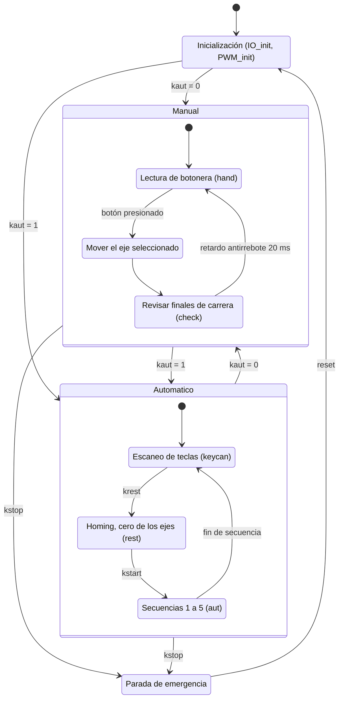

# Diagrama de estados del firmware

> **Borrador.** Está armado a partir de la estructura del `main()` descrita en la documentación anterior (super-loop con modo manual y automático). Hay que verificarlo contra el código real del PIC y corregir nombres de estados y transiciones.

El diagrama está escrito en Mermaid: es texto, se edita aquí mismo y la página lo dibuja sola. Para probar cambios rápido se puede usar https://mermaid.live

## Preguntas a resolver con el código

- ¿El homing se ejecuta solo al pulsar `krest` o también al encender?
- ¿`kstop` detiene los motores en cualquier punto de la secuencia o solo entre pasos?
- ¿Qué hace cada una de las 5 secuencias automáticas?
